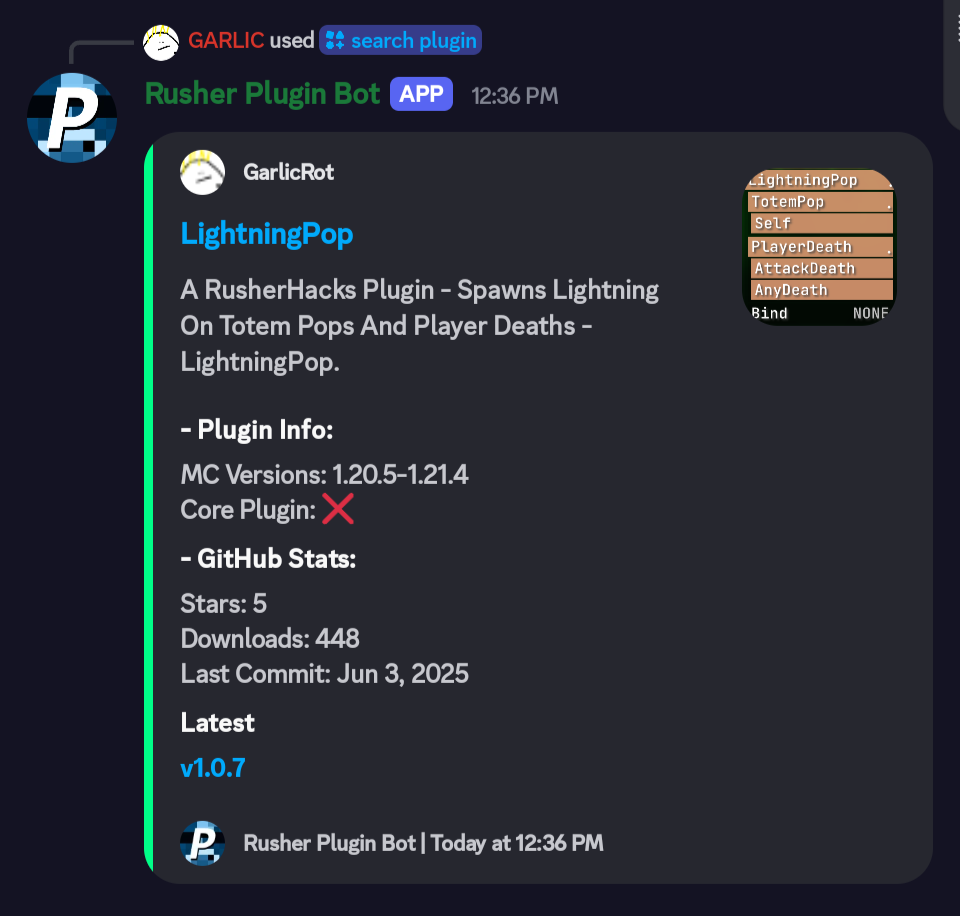
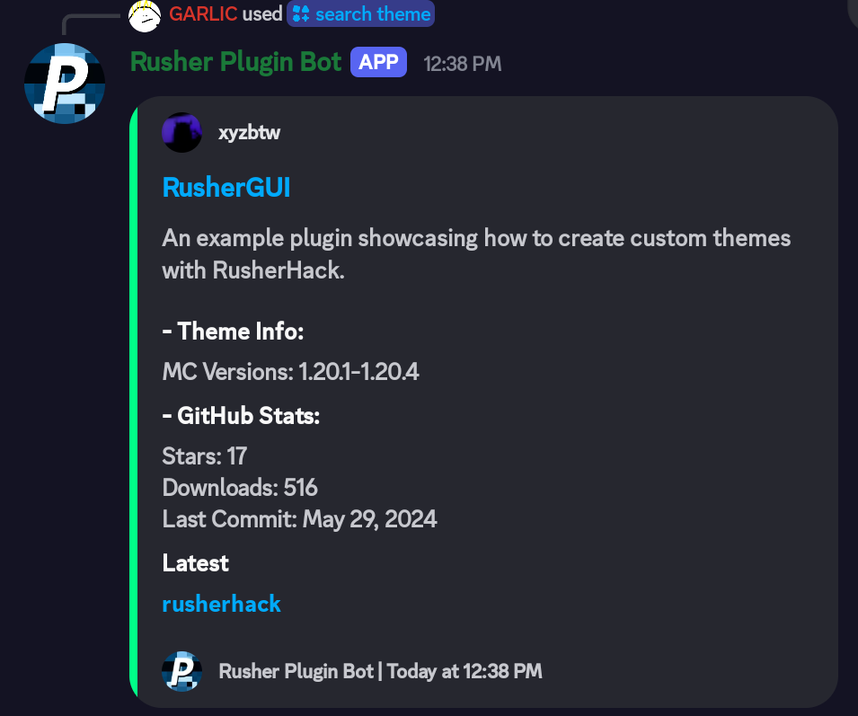
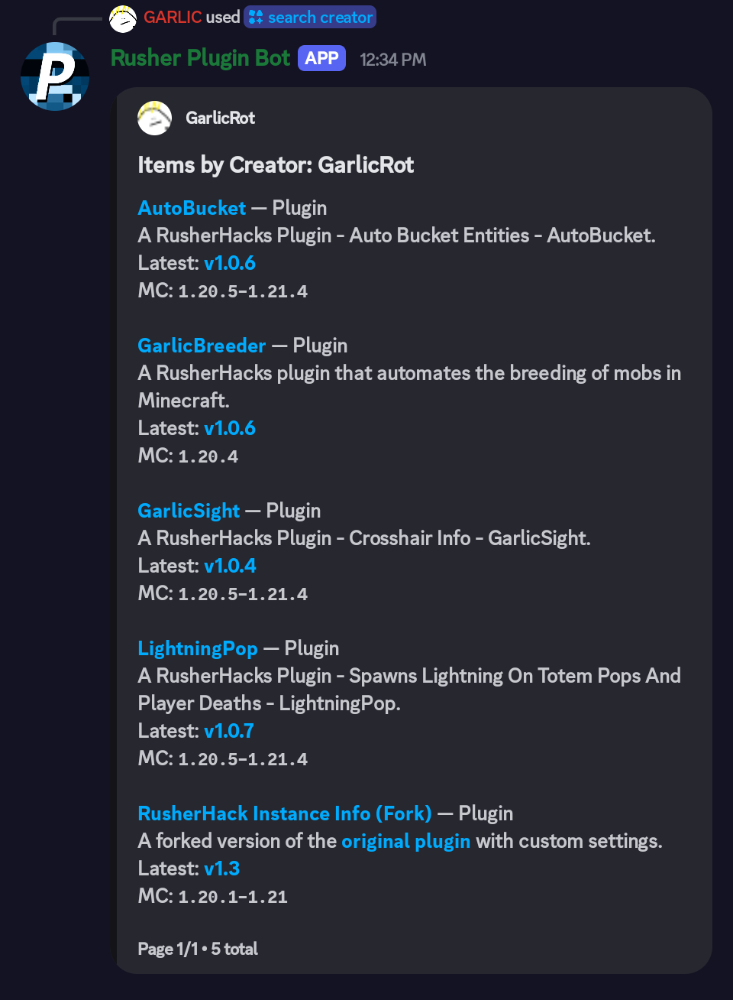
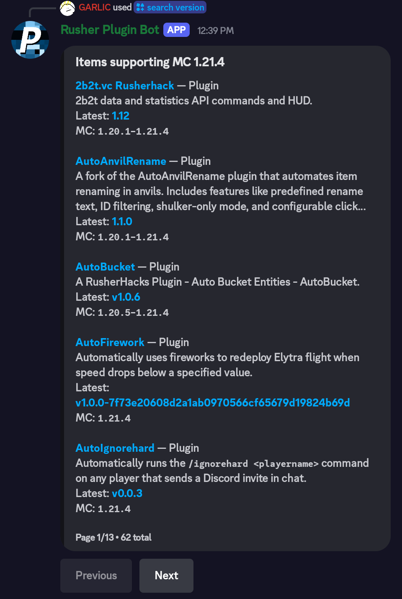

<p align="center">
  
</p>

<h1 align="center">Rusher Plugin Bot</h1>

<p align="center">
  Explore the RusherHack plugin and theme registry, right inside Discord.
</p>

<p align="center">
  <a href="https://github.com/GarlicRot/Rusher-Plugin-Bot/actions/workflows/ci.yml"></a>
  
  
  <a href="https://discord.com/oauth2/authorize?client_id=1402508845582123128&scope=bot%20applications.commands"></a>
</p>

---

Rusher Plugin Bot makes it easy to discover community plugins and themes for **RusherHack** without leaving Discord. It reads from the official [RusherDevelopment plugin and theme registry](https://github.com/RusherDevelopment/rusherhack-plugins/blob/main/data/plugins-and-themes.yml), then presents the available information using searchable slash commands, autocomplete, and clean embeds.

The registry is the source of truth for plugin listings and Minecraft versions. GitHub repository statistics are optional enhancements, not compatibility guarantees.

## Commands

| Command | Options | Description |
| --- | --- | --- |
| `/search plugin` | `name` — required | Look up an individual plugin. |
| `/search theme` | `name` — required | Look up an individual theme. |
| `/search creator` | `name` — required; `mc_version` — optional | Browse plugins and themes by creator, optionally filtering by Minecraft version. |
| `/search version` | `mc_version` — required | Browse registry entries listed for a specific Minecraft version. |
| `/refresh` | No options | Refresh the registry (maintainer-only). |

All search options support autocomplete where applicable. **Plugin and theme searches use only the `name` option**; Minecraft-version filtering is available in creator and version searches.

### `/search plugin`

Search for a plugin by name to view its description, creator, latest release, complete list of Minecraft versions recorded in the registry, and available GitHub information. Core plugins are visually distinguished from other plugins.

<details>
<summary><strong>Screenshot</strong></summary>

<p align="center"></p>

</details>

### `/search theme`

Find a theme by name and view its creator, description, release details, listed Minecraft versions, and available GitHub information in a purple-accented embed.

<details>
<summary><strong>Screenshot</strong></summary>

<p align="center"></p>

</details>

### `/search creator`

Browse every plugin and theme listed for a particular creator. Results include descriptions, latest release links, the **full list of Minecraft versions** recorded for each entry, and available GitHub stars and release-asset download counts.

- Five items per page, with **Previous** and **Next** buttons.
- Autocomplete for creator names.
- Optional `mc_version` filter with suggestions derived from that creator's registry entries.

<details>
<summary><strong>Screenshot</strong></summary>

<p align="center"></p>

</details>

### `/search version`

Choose a Minecraft version from autocomplete to see plugins and themes listed for it in the official registry. Results use a gold-accented embed and include descriptions, latest releases, and available GitHub stars and downloads.

- Five items per page, with **Previous** and **Next** buttons.
- Autocomplete is populated from Minecraft versions recorded in the registry.
- Plugin and theme counts are shown in the results footer.

<details>
<summary><strong>Screenshot</strong></summary>

<p align="center"></p>

</details>

> **Note:** Screenshots may show an earlier version of the interface. Command descriptions above reflect v2.

## How It Works

### Registry data

The bot loads the public [plugins-and-themes.yml](https://github.com/RusherDevelopment/rusherhack-plugins/blob/main/data/plugins-and-themes.yml) maintained by RusherDevelopment. It normalizes the entries for searching, refreshes the registry periodically, and uses cached data when GitHub is temporarily unavailable. Searches do not depend on live GitHub repository statistics.

Minecraft versions displayed by the bot are **versions listed in the registry**, not a guarantee that every plugin has been independently tested against that version.

### GitHub statistics

Where available, embeds include:

- **Stars** from the plugin's GitHub repository.
- **Downloads** summed from GitHub release assets (not unique users or installations).
- **Last commit** information on individual plugin and theme details.

v2 uses request deduplication, a statistics cache, GitHub API rate-limit protection, and last-known-good statistics during temporary API failures. A `GITHUB_TOKEN` is optional but recommended for higher GitHub API limits. Statistics may be missing if GitHub has not supplied them. **Statistics caching is currently in memory and resets when the bot restarts.**

## Running Locally

The project uses **Node.js 24** in GitHub Actions.

```bash
git clone https://github.com/GarlicRot/Rusher-Plugin-Bot.git
cd Rusher-Plugin-Bot
npm ci
```

Create a local `.env` file with the credentials for **your own Discord application**:

```dotenv
DISCORD_TOKEN=your_discord_bot_token
CLIENT_ID=your_discord_application_id
GITHUB_TOKEN=your_optional_github_token
```

Then start the bot:

```bash
npm start
```

Starting the process does **not** register Discord slash commands. Registration is a separate operation. The repository's `scripts/deploy-dev.js` is specifically restricted to the maintainer's development application and test server; it is not a general-purpose registration script. **`npm run register` replaces the application's global commands**, so only use it when you deliberately intend to register commands for the application identified by your credentials.

Never publish a `.env` file or share your Discord or GitHub tokens.

### Tests

```bash
node --test test/*.test.js
npm audit --omit=dev
```

The [CI workflow](.github/workflows/ci.yml) runs syntax checks, automated tests, and a dependency security audit.

## Deployment and Rollback

The official bot runs under systemd using versioned releases and a `current` symlink. The release directory is prepared and tested separately, and the previous release is retained for rollback. Production configuration remains private, and updating global slash commands is treated as a separate deployment step.

Bot code and Discord's registered command definitions are separate: after changing slash-command options, the new definitions must be registered with Discord. Existing commands should be backed up before doing so.

## Contributing

Issues, bug reports, and pull requests are welcome. Please see [CONTRIBUTING.md](CONTRIBUTING.md) for contribution guidelines. The [CHANGELOG.md](CHANGELOG.md) is generated from the repository's commit history by GitHub Actions.

---

<p align="center"><sub>Independent community project · Registry data provided by <a href="https://github.com/RusherDevelopment/rusherhack-plugins">RusherDevelopment</a></sub></p>
